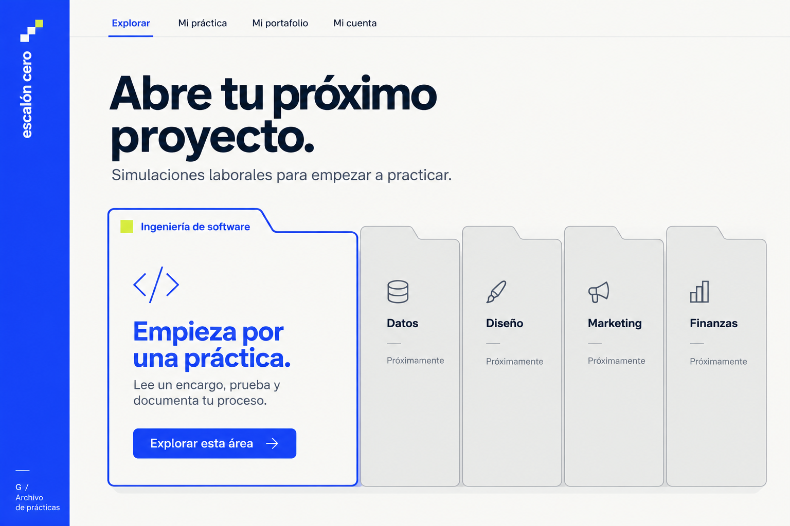

# Escalón Cero

**Tu experiencia empieza haciendo.** Una plataforma para practicar tareas de un rol junior, documentar resultados y compartir un primer proyecto de portafolio.

MVP construido durante DSC HACK 2026. La primera actividad es una simulación de QA de una tienda online. Las demás áreas y roles se presentan como próximos contenidos.

**Demo:** https://escalon-cero-ruddy.vercel.app · **Código:** https://github.com/MarceloMT0/escalon-cero



La portada implementa la opción G (archivo de prácticas), con carpetas interactivas. La [referencia visual anterior](docs/assets/referencia-aprobada.png) se conserva como antecedente.

## Ejecutar

Requisitos: Node.js 24 LTS y npm.

```powershell
npm ci
npm run dev
```

Abrir la URL local que imprime Next.js. Sin variables de entorno, todo el recorrido funciona en modo de demostración: los textos se guardan en localStorage y los archivos en IndexedDB del navegador. No hay cuentas compartidas ni sincronización entre dispositivos en ese modo.

## Recorrido funcional

1. Buscar áreas, roles o actividades desde el inicio, o explorar las carpetas de áreas y sus roles. La pantalla `/buscar/` permite combinar filtros y conserva los criterios en su URL. Ingeniería de software → QA / Testing reúne hoy una actividad disponible; el catálogo está diseñado para incorporar más.
2. Abrir el encargo de QA y empezar la práctica.
3. Leer cinco requisitos y probar una tienda con errores educativos reproducibles.
4. Guardar al menos tres casos ejecutados, dos reportes y una reflexión.
5. Adjuntar evidencias privadas opcionales y revisar una rúbrica de estructura.
6. Registrar la entrega y generar un portafolio compartible.

El enlace de portafolio lleva una copia del texto codificada en su fragmento `#`. Funciona en otro navegador sin acceder al borrador privado; no contiene archivos adjuntos. No ofrece revocación ni edición retroactiva. El autor debe revisar el contenido y confirmar que quiere compartirlo.

## Activar cuentas con Supabase

1. Crear un proyecto Supabase y aplicar `supabase/migrations/202610290001_practice.sql`.
2. Habilitar autenticación por correo. Configurar la URL del sitio y las URLs de retorno para el dominio desplegado y el entorno local.
3. Copiar `.env.example` a `.env.local` y configurar `NEXT_PUBLIC_SUPABASE_URL` y `NEXT_PUBLIC_SUPABASE_PUBLISHABLE_KEY`.
4. Reiniciar desarrollo o volver a compilar. Son variables públicas incluidas durante el build.
5. Desde **Mi cuenta**, crear una cuenta y confirmar el correo si el proyecto lo exige. En **Mi práctica**, sincronizar o recuperar explícitamente la copia de la cuenta.

**Nunca usar una clave service_role en la aplicación.** La migración restringe borradores y archivos al dueño mediante RLS. Sin un proyecto configurado, la integración existe en el código pero no se considera verificada en producción.

El proyecto de esta entrega ya está configurado; sus identificadores no secretos están en `supabase/project.json`. La migración está aplicada y registrada, y las URLs de autenticación se declaran en `supabase/config.toml`. Se comprobaron inicio de sesión, sincronización, archivos privados y aislamiento entre usuarios con cuentas sintéticas eliminadas al terminar.

El correo incorporado de Supabase solo envía confirmaciones a miembros del equipo. Para abrir el registro por correo a personas externas, configurar [SMTP propio](https://supabase.com/docs/guides/auth/auth-smtp). La verificación de correo permanece activa. La demo se puede completar y compartir sin crear una cuenta.

## Comprobar

```powershell
npm run check
npm run build
npm run preview
```

En otra terminal, con el preview funcionando:

```powershell
npx playwright install chromium
npm run qa:browser
```

La QA prueba catálogo, borradores, tienda, archivos, entrega, enlace compartido desde una sesión independiente y móvil. También audita accesibilidad con axe en las vistas indicadas en `output/playwright/qa-results.json`. Son comprobaciones automáticas y no sustituyen una prueba con una persona real.

`npm run qa:cloud` comprueba Supabase y la sincronización real desde navegador. Requiere autorización explícita con `SUPABASE_TEST_ALLOW_WRITE=true`, `SUPABASE_TEST_PROJECT_REF`, las dos variables públicas y una credencial administrativa en `SUPABASE_TEST_SERVICE_KEY`, suministrada solo al proceso de prueba. Crea cuentas sintéticas, comprueba aislamiento y limpia sus propios datos al terminar. No configurar esa credencial en Vercel ni en variables `NEXT_PUBLIC_*`.

## Desplegar en Vercel

Este repositorio está vinculado al proyecto Vercel `escalon-cero`. `vercel.json` configura Next.js; Vercel detecta su exportación estática automáticamente. No fijar `outputDirectory` a `out` en el adaptador Next.js de Vercel, porque este debe leer primero los manifiestos de `.next/`. Las dos variables públicas de Supabase están configuradas en producción, preview y desarrollo. El repositorio incluye formato, validación de código, tipos, pruebas y build en GitHub Actions.

También se puede desplegar el directorio `out/` en un alojamiento estático con rutas por directorio. La aplicación no requiere un servidor Node en producción; Supabase proporciona el backend cuando está configurado.

## Documentación

- [Arquitectura](ARCHITECTURE.md)
- [Requisitos y alcance](docs/requirements.md)
- [Competencia y pendientes humanos](docs/hackathon.md)
- [Validación técnica](docs/validation.md)
- [Reglas para contribuir](AGENTS.md)

Fuentes tipográficas bajo OFL, con sus licencias en `public/fonts/`. Ilustración de escalones creada para el proyecto mediante generación de imágenes. La tienda, sus pedidos y su empresa son ficticios. Escalón Cero no garantiza contratación ni certifica competencia profesional.
